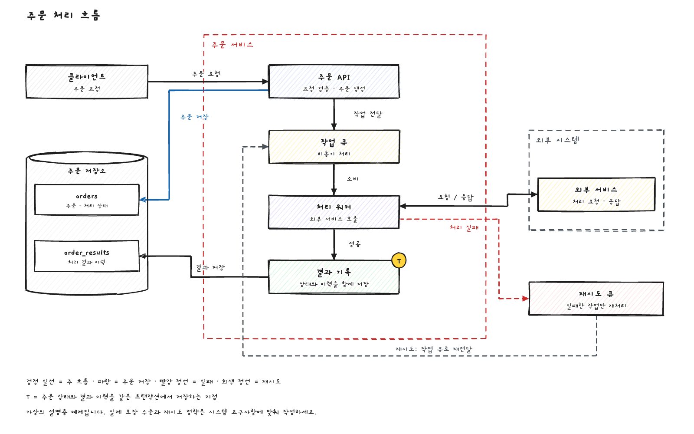

# Sketch Flow

Rough.js + SVG로 손그림 느낌의 시스템 구성도와 처리 흐름도를 만드는 에이전트 스킬입니다.

흰 바탕에 한글 손글씨, 빗금 채움, 원통형 저장소, 직각 화살표, 색상별 경로와 흰색 라벨 외곽선을 사용합니다. 별도 빌드 없이 HTML로 결과를 확인하고 수정할 수 있습니다.

## 예시

[](assets/flow-preview.png)

이미지를 클릭하면 크게 볼 수 있습니다. [HTML 예제·템플릿](assets/flow-template.html)을 내려받아 직접 열고 수정할 수 있습니다.

## 설치

Codex 기본 경로:

```sh
git clone https://github.com/UjiinEatingTangerines/sketch-flow-skill.git ~/.codex/skills/sketch-flow
```

`CODEX_HOME`을 따로 지정했다면 그 경로의 `skills/sketch-flow`에 설치하세요. Claude Code에서는 `~/.claude/skills/sketch-flow`에 복제할 수 있습니다. 설치 후 새 세션에서 스킬을 불러옵니다.

## 사용

```text
$sketch-flow로 주문 API → 작업 큐 → 워커 → 저장소 흐름을 그려주세요.
실패 재시도는 빨간 점선으로, 외부 시스템은 경계로 구분해주세요.
```

- [스킬 지침](SKILL.md)
- [실행 가능한 HTML 예제·템플릿](assets/flow-template.html): 내려받아 브라우저에서 여세요.

예제는 가상의 주문 처리 흐름입니다. Rough.js 4.6.6 CDN과 Google Fonts를 사용하므로 인터넷 연결이 필요합니다. 오프라인 배포는 의존성을 별도로 포함해야 합니다. 자동 캡처 시에도 글꼴 로딩을 기다리세요.

Rough.js는 MIT, Gaegu는 SIL Open Font License로 배포되는 외부 의존성입니다. 이 저장소에는 해당 라이브러리·글꼴 파일을 포함하지 않습니다.
